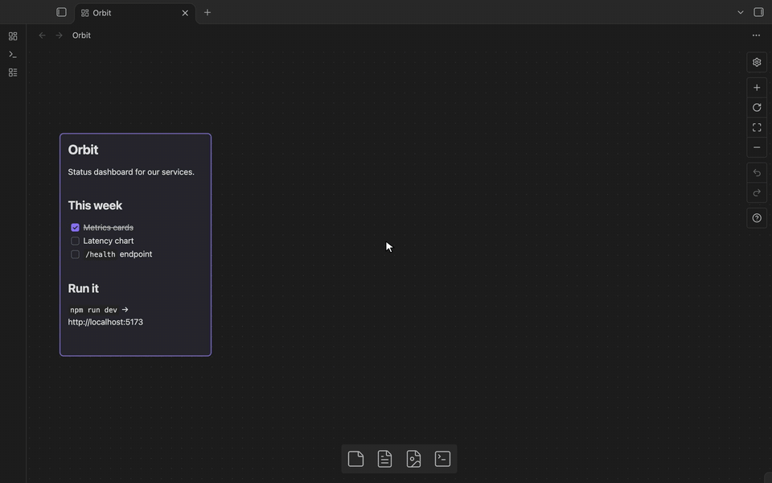
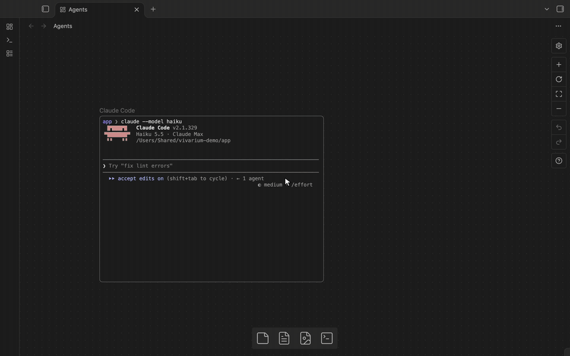

<div align="center">

# Vivarium

**Live programs on your Obsidian Canvas.**<br>
Terminals, coding agents, dev servers and web pages as tiles next to your notes. They keep running
while you pan away, close the canvas or quit Obsidian.



</div>

---

## What it is

Obsidian Canvas is a great place to *think*. Vivarium makes it a place to *work*: put the programs
you're working with next to the notes about them, on one infinite plane.

| Tile | What it is | Feels |
|---|---|---|
| **Terminal** | Any command (`zsh`, `claude`, `codex`, `npm run dev`, `htop`) in a real terminal, backed by tmux | Native: keystroke → echo in **0.6 ms** (p50) |
| **Web** | A real browser page inside the card (`localhost:3000`, docs, dashboards) | Native: direct input, scales with the canvas, Obsidian keeps focus |
| **App window** *(macOS, experimental)* | Any app's window as a live preview; click it to work in the real window | Live preview at 60 fps; native once clicked |

Plus **semantic zoom**: zoom out and your workspace stays readable. Card headlines and group titles
are kept at screen size, like labels on a map, while live tiles freeze on their last picture.

## Highlights

### Agents can arrange the canvas

Every tile knows who it is (`$VIVARIUM_TILE`), so a coding agent running in one can open programs
next to itself, leave notes, and read or type into other tiles:



```sh
vivarium add -- npm run dev            # new tile beside me, connected with an arrow
vivarium note "Plan: 1) … 2) …"        # text card beside me
vivarium read t3k9x2a --lines 50       # what does that program show?
vivarium send t3k9x2a "npm test"       # type a command (+ Enter)
```

Telling an agent *"you're in a Vivarium tile, run `vivarium help`"* is enough for it to use this.

### Big workspaces stay readable

Canvas unmounts card content below ~30% zoom to stay fast, and text cards go blank. Vivarium
replaces them with each card's first heading at a readable size, then hands over to group titles
when cards become specks:


### Things keep running

- **Terminals live in tmux.** Quit Obsidian, reopen it: every program is still running, with its
  scrollback, its screen (including full-screen apps like `vim` and `htop`) and its cursor.
- **Attach from anywhere:** `tmux -L vivarium attach -t vivarium:<id>`, or `vivarium attach`.
- **Web tiles remember their page** and keep their logins (own browser profile).

## Install

Vivarium isn't in the community plugin directory (yet). Build it from source:

**Requirements:** Obsidian 1.5+ (desktop), Node 20+, `tmux` (`brew install tmux` / `apt install tmux`).
App tiles additionally need macOS 14+ and the Xcode Command Line Tools.

```sh
git clone git@github.com:Encrux/vivarium.git && cd vivarium
npm install
npm run build:helper   # macOS only: the native helper for app tiles (optional)
npm run build          # → dev-vault/.obsidian/plugins/vivarium/

# link it into your vault and enable "Vivarium" under Settings → Community plugins
ln -s "$PWD/dev-vault/.obsidian/plugins/vivarium" "<your vault>/.obsidian/plugins/vivarium"

# optional: the CLI for agents
ln -s "$PWD/bin/vivarium" /opt/homebrew/bin/vivarium
```

## Using it

**Add a tile.** All of these open the same picker. Type a command, a URL or an app name:

| Where | How |
|---|---|
| Right-click on empty canvas | **Add program…**, next to Canvas's own *Add card / note / media* |
| Canvas toolbar | the `>_` button: click it to open the picker, drag it to drop a tile where you release |
| Command palette | **Vivarium: Add program to canvas…** |
| Hotkeys | each preset (Shell, Claude Code, Codex, htop, …) has its own command you can bind |

**Work in it.** Click a tile to select it, then click or type inside it. Unselected tiles never take
your scroll wheel, so panning a crowded canvas stays smooth. Each tile is a small file in `Vivarium/`
(`.term`, `.web`, `.window`). Open it in a tab, embed it in a note with `![[htop.term]]`, or delete it to
stop the program.

**App tiles (macOS).** Pick an app (Safari, Simulator, Figma, …) in the picker. The real window
lives on an invisible virtual display and is streamed into the tile. Click the tile and the real
window comes forward over it, so you use the actual app. Click the canvas to send it back. This
needs **Screen Recording** and **Accessibility** for Obsidian (System Settings → Privacy & Security).
Prefer **web tiles** for anything that runs in a browser: they're instant and never switch focus.

## How it works

```
Canvas file card ─► Embed ─┬─► Terminal tile  xterm.js (DOM renderer) ◄─────────┐
                           │                       │ keys (send-keys)              │ raw bytes
                           │                       ▼                               │
                           │      ONE tmux control-mode client (tmux -C) ─────────┘
                           │                       │
                           │      tmux server (-L vivarium), one window per tile
                           │
                           ├─► Web tile       <webview> (Chromium, in-process with Obsidian)
                           │
                           └─► App tile       WebCodecs H.264 decoder ◄── native helper (Swift)
                                                   ScreenCaptureKit → VideoToolbox (hardware)
                                                   windows parked on a CGVirtualDisplay "stage"
```

**Performance is a feature.** Every tile only costs something while you can see it:

| State | Terminal | App window | Web |
|---|---|---|---|
| visible | output written to xterm | stream at 60 fps (selected) / 8 fps | live |
| off-screen / zoomed far out | raw bytes buffered, nothing parsed or painted; a noisy hidden tile gets tmux output switched off entirely | stream stopped, last frame kept | not painted, keeps running |
| back on screen | flush the buffer, or repaint from a tmux snapshot | resume | instant |

Measured with **30 terminals each printing ~20 coloured lines/s** (Obsidian 1.15, MacBook Air):

| | |
|---|---|
| close-up / panning across the grid / zoomed to fit | **60 fps**, p95 ≈ 17 ms, no long tasks |
| keystroke → echo | **p50 0.6 ms**, p95 11 ms |
| semantic zoom on 160 cards: panning / zooming through all levels | **60 fps** / ~60 fps |

## Platform status

| | macOS | Linux |
|---|---|---|
| Terminal tiles | ✅ | should work (tmux + Node); untested |
| Web tiles | ✅ | should work; untested |
| App tiles | ✅ experimental | planned: virtual display per app via Xpra |
| `vivarium` CLI | ✅ | should work; untested |

Windows isn't supported (no tmux).

## Caveats

- **Uses Obsidian internals** that plugins can't reach through the public API: `embedRegistry`,
  `canvas.showCreationMenu`, `canvas:node-menu`, `importData`. An Obsidian update can break them.
  Each touch point is small and isolated.
- **Web tiles run Obsidian's bundled Chromium,** which only updates when you install a new Obsidian
  release, not with in-app updates. Keep that in mind before browsing arbitrary sites in them.
- **App tiles rely on a private macOS API** (`CGVirtualDisplay`, also used by DeskPad and
  BetterDisplay). Using an app still switches focus to it, as macOS requires.
- **Granting Accessibility to Obsidian** lets any Obsidian plugin post input to other apps.

## Development

```sh
npm run dev            # rebuild on change into dev-vault/
npm run build          # typecheck + build once
npm run build:helper   # rebuild the Swift helper (macOS)
```

Open `dev-vault/` as a vault, or symlink the plugin folder into another vault. Toggle the plugin to
reload it. The helper speaks a small JSON-lines / framed-binary protocol over stdin/stdout
(`helper/macos/Sources/VivariumHelper/Protocol.swift`), so a Linux helper can slot in behind the
same plugin code.

---

<sub>Inspired by FlutterFlow's <a href="https://campus.flutterflow.io/">Campus</a>, built on Obsidian's own Canvas.</sub>
