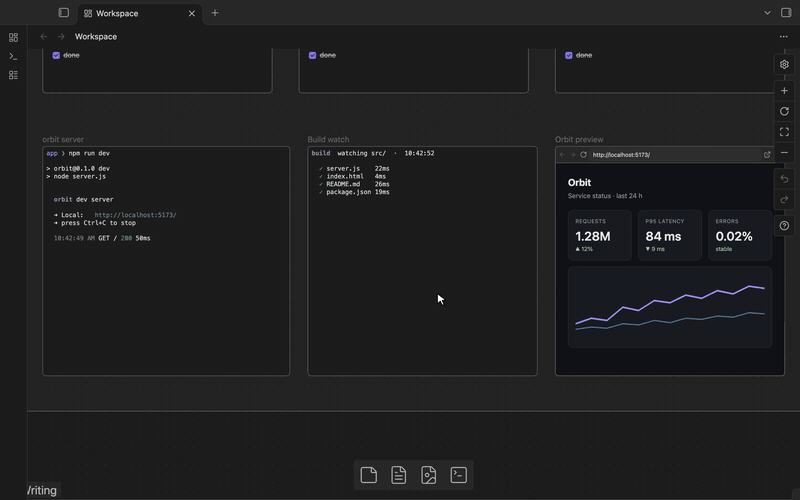

<div align="center">

# Vivarium

Live programs on your Obsidian Canvas.


</div>

Vivarium puts terminals, coding agents, dev servers and web pages on a canvas, next to your notes.
They keep running when you close the canvas or quit Obsidian.

> [!NOTE]
> This project was built for personal use. The highest priority was a working prototype, quickly,
> so AI was used extensively. Expect rough edges.

## Features

- Terminal tiles run any command (`zsh`, `claude`, `codex`, `npm run dev`, `htop`) in a real terminal.
- Web tiles show a page, like the app your dev server is serving.
- App tiles show another program's window (experimental).
- After a reboot or crash, tiles start again where they were. Claude Code and Codex tiles resume
  their own conversation.
- Coding agents in a tile can open tiles next to themselves, fork their conversation into a new
  tile, and read or type into other tiles:


- Zoomed out, card titles stay readable:



## Install

You need Obsidian 1.5+ (desktop), Node 20+ and tmux (`brew install tmux` or `sudo apt install tmux`).
Vivarium isn't in the community plugin directory yet, so you build it from source:

```sh
git clone https://github.com/Encrux/vivarium.git && cd vivarium
sh scripts/update.sh ~/path/to/your/vault
```

Then turn on Vivarium in Settings → Community plugins. To update, run `sh scripts/update.sh` again
and turn the plugin off and on.

App tiles need a small helper program:

- macOS 14+: run `npm run build:helper` before `update.sh` (needs the Xcode Command Line Tools),
  and allow Obsidian under Screen Recording and Accessibility in System Settings.
- Linux (Wayland): `sudo apt install cargo pkg-config libxkbcommon-dev libgbm-dev`, then `update.sh`
  builds it.

## Usage

Right-click an empty spot on a canvas and choose **Add program…**, or use the `>_` button in the
canvas toolbar. Type a command, a URL or an app name.

- Click a tile to select it, click again to type into it.
- Double-click a tile's name to rename it.
- Each tile is a small file in `Vivarium/`. Delete the file to stop the program.
- In a terminal every key goes to the program, except Obsidian's shortcuts (Cmd on macOS,
  Ctrl+Shift on Linux).

### Agents

Agents running in a tile get a `vivarium` command and a skill that explains it. There's nothing to
set up.

```sh
vivarium add -- npm run dev          # start a program in a new tile next to mine
vivarium fork "try it with SQLite"   # continue this conversation in a new tile
vivarium send <tile> "npm test" --wait
vivarium read <tile>
```

Codex asks before each use because of its sandbox. Settings → Coding agents can allow the commands
that only read or arrange the canvas.

### Git and sync

Committing your vault with its tiles is fine, for example as a backup. A tile file holds the
command, not the running program, and a tile that arrives through a pull or sync doesn't start
until you press its Start button. Don't put secrets into commands or URLs, since those are saved in
the tile files.

## Platforms

| Platform | Support |
|---|---|
| macOS 14+ | Supported |
| Linux (Wayland) | Supported, tested on Ubuntu 26.04 |
| Windows | Not supported, no tmux ([#3](https://github.com/Encrux/vivarium/issues/3)) |
| Obsidian mobile | Not supported |

Where macOS and Linux differ:

| | macOS | Linux |
|---|---|---|
| App tiles | 🟡 | 🟡 |
| GPU-rendered apps in app tiles | 🟢 | 🟡 |
| Windows that are already open, in app tiles | 🟡 | 🔴 [#4](https://github.com/Encrux/vivarium/issues/4) |
| Web tiles | 🟢 | 🟡 |
| Programs keep running through a logout | 🔴 | 🟡 |

🟢 works · 🟡 experimental · 🔴 not available

## Roadmap

Ideas, not scheduled. Comments welcome on the issues.

- [ ] Show already-open windows in app tiles on Linux, e.g. your normal Firefox ([#4](https://github.com/Encrux/vivarium/issues/4))
- [ ] Several people working on one canvas ([#1](https://github.com/Encrux/vivarium/issues/1))
- [ ] Continue a tile on another machine ([#2](https://github.com/Encrux/vivarium/issues/2))
- [ ] Windows support ([#3](https://github.com/Encrux/vivarium/issues/3))

## More

- [How it works](docs/how-it-works.md): architecture, performance, crash recovery, git details, caveats
- [Contributing](CONTRIBUTING.md): building, testing, the helpers

<sub>Inspired by FlutterFlow's <a href="https://campus.flutterflow.io/">Campus</a>.</sub>
